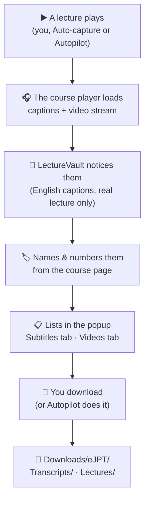
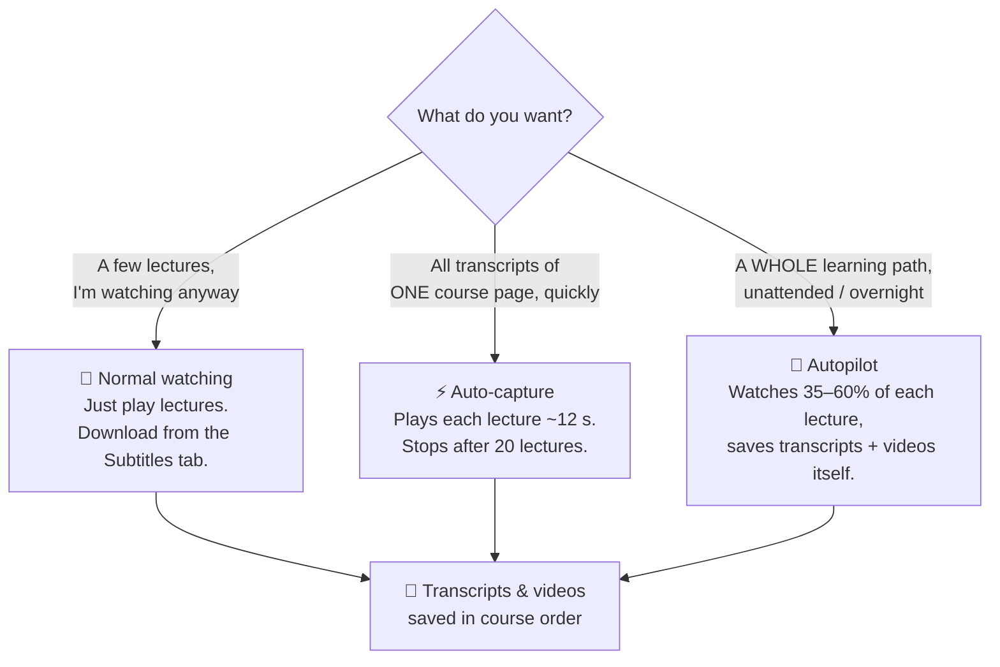
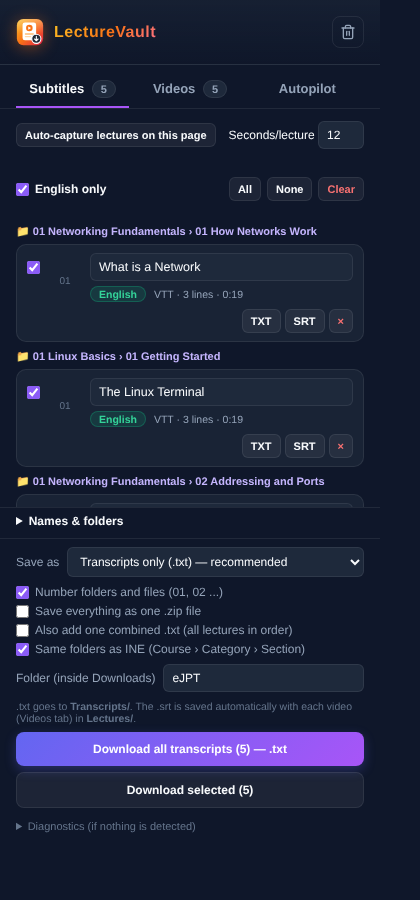
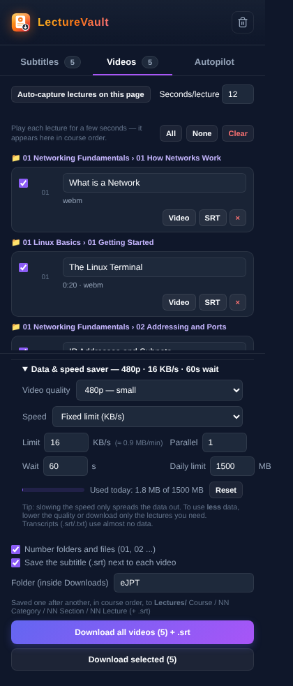
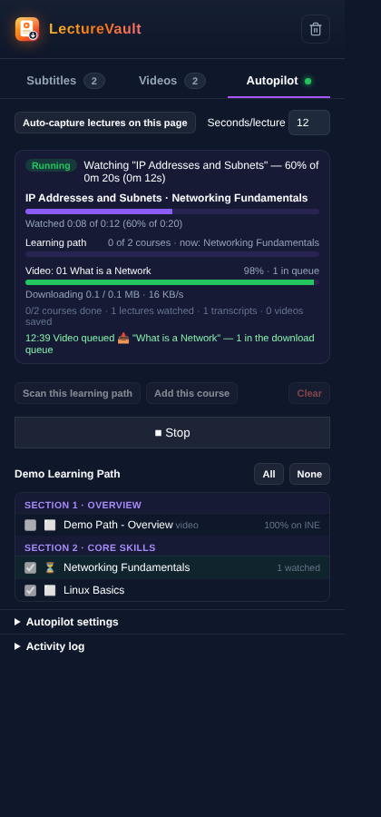

<div align="center">


# LectureVault

**A Chrome extension that saves the transcripts (and, if you want, the videos) of the course lectures you watch — named, numbered and sorted into folders exactly like the course.**

`Version 1.13.0` · `Chrome / Edge (Manifest V3)` · `Private project — personal study use`

</div>

---

## 📌 In one minute

| | |
|---|---|
| **What is it?** | A browser extension (it lives in Chrome's toolbar). |
| **Why does it exist?** | I learn better from written notes than from video, and typing notes is slow. LectureVault saves each lecture's transcript as a clean `.txt` file so I can read it, search it, and turn it into notes. |
| **What does it save?** | Transcripts (`.txt`), subtitles (`.srt`) and lecture videos — sorted like the course: `Course › Section › Card › Lecture`. |
| **How do I use it?** | Three ways: **(1)** just watch lectures normally, **(2)** press *Auto-capture* on a course page, or **(3)** let **Autopilot** work through a whole learning path. |
| **Where do files go?** | `Downloads\eJPT\Transcripts\...` and `Downloads\eJPT\Lectures\...` |
| **Built for** | INE course pages (eJPT path). Other sites: basic video/subtitle detection only. |

> ⚠️ **Read [Risks & safe use](docs/06-risks-and-safe-use.md) before using Autopilot or downloading videos.** It explains what can happen to your account, your mobile data and your laptop.

> ### 🛑 Daily rule — read this every time
> - **Never download more than 30–40 videos in one day.**
> - **After 30–40 videos, take a full day off** (alternate days is best) — **or at least a 10–14 hour gap** before the next run.
> - Easy way to follow it: set **Stop after** to about **2 h** and/or **Max lectures/day** to **30**, and don't start again the same day.
> - If INE ever shows *"The user has watched the maximum number of minutes. Please wait 24 hours or contact the support team"* — you already went too far. Autopilot stops by itself; **wait the full 24 hours** and do less next time.

> 🧠 **Habit to remember every time:** change *Watch %*, waits, speed step and start time between Autopilot runs, do only 1–2 courses per run, skip some nights and mix in real watching. LectureVault already randomizes its own timing — but **doing less** is what really keeps risk low. → [Habits to remember](docs/05-autopilot.md#-habits-to-remember-every-time)

---

## 🧭 How it works (the big picture)



Nothing is captured unless a lecture actually plays — LectureVault only *listens* to what the course player loads anyway, then saves it neatly.

---

## 🚦 Which mode should I use?



| Mode | Effort | Speed | Data use | Risk level |
|---|---|---|---|---|
| 👀 Normal watching | You watch everything | Slow | Normal streaming | 🟢 Lowest |
| ⚡ Auto-capture | 1 click per 20 lectures | ~6–8 min per 20 lectures | Small (12 s per lecture) | 🟡 Medium |
| 🤖 Autopilot | Press Start once | Hours per path | **High** (35–60% of every video + optional downloads) | 🟠 Highest |

---

## 🖼️ What it looks like

| Subtitles tab | Videos tab + Data & speed saver | Autopilot (running) |
|---|---|---|
|  |  |  |

*(Screenshots are made from the real extension running on a demo course site — no real course content.)*

---

## 🚀 Quick start (5 minutes)

1. **Install** — `chrome://extensions` → turn on **Developer mode** → **Load unpacked** → pick this folder.
2. **Pin it** — puzzle-piece icon → 📌 next to *LectureVault*.
3. **Open a course page** and **play a lecture** for a few seconds.
4. Click the **LectureVault** icon → **Subtitles** tab → the lecture appears.
5. Click **Download all transcripts — .txt** → files land in `Downloads\eJPT\Transcripts\`.

👉 Full walkthrough: **[Quick start](docs/01-quick-start.md)**

---

## 📚 Guides (read the one you need)

| # | Guide | Read it when you want to… |
|---|---|---|
| 1 | [Quick start](docs/01-quick-start.md) | install it and save your first transcript |
| 2 | [Transcripts only](docs/02-transcripts.md) | save just the text (`.txt` / `.srt`), sorted by course |
| 3 | [Videos & Data-and-speed saver](docs/03-videos-and-data-saver.md) | download videos; understand *Like watching*, *Half time*, *Quarter time*, *Full speed*, *Parallel*, the **daily (24-hour) data limit** |
| 4 | [Auto-capture](docs/04-auto-capture.md) | grab all transcripts of one course page quickly |
| 5 | [Autopilot](docs/05-autopilot.md) | scan a learning path and let it run course after course |
| 6 | [Risks & safe use](docs/06-risks-and-safe-use.md) | know what can go wrong if you push it too hard |
| 7 | [Troubleshooting](docs/07-troubleshooting.md) | fix "nothing captured", wrong names, stuck runs |
| 8 | [How it works (code)](docs/08-how-it-works.md) | change the code — file map and diagrams |
| 9 | [GitHub (private repo)](docs/09-github.md) | upload or update this project on GitHub, or install it on another PC |
| — | [Changelog](docs/CHANGELOG.md) | see what changed in each version |
| — | [Feature list (PDF)](docs/LectureVault-Features.pdf) | a 2-page printable summary |

---

## ✅ Feature checklist

**Capturing**
- [x] Detects HLS (incl. AES-128 encrypted), MP4 and WEBM streams
- [x] Captures English captions only (others ignored) · no duplicates
- [x] Ignores the course trailer, thumbnail tracks, quizzes and labs
- [x] Names files from the course page, keeps real lecture numbers
- [x] Lists survive reloads, course changes and closing the tab (until you press **Clear**)

**Downloading**
- [x] Transcripts as `.txt`, subtitles as `.srt`, or both · optional `.zip` or one combined `.txt`
- [x] Videos one after another, each with its `.srt`
- [x] Data & speed saver: quality cap, speed slider, KB/s limit, parallel pieces, wait between videos, daily data limit

**Automation**
- [x] Auto-capture: one course page, ~12 s per lecture, pauses after 20
- [x] Autopilot: whole learning path, watches 35–60%, saves transcripts + videos, resumes after any interruption
- [x] Autopilot **Stop after** slider (Off · 30 min · 1 h · 1½ h · 2 h · 3 h · 4 h · 6 h · 8 h) and optional **Max lectures/day**
- [x] Autopilot stops by itself when INE shows its daily "maximum number of minutes / wait 24 hours" message

---

## 🗂️ What's in this folder

```text
LectureVault/
├── manifest.json          ← extension definition (name, version, permissions)
├── background.js          ← video downloader engine + data/speed saver
├── subs-library.js        ← caption capture, naming, lists, auto-capture
├── autopilot.js           ← autopilot engine (runs in the background)
├── subtitle-utils.js      ← text cleaning, .srt/.txt conversion, naming helpers
├── popup.html / .css      ← the popup window
├── popup.js · subs.js · videos.js · netprefs.js · autocap.js · autopilot-ui.js
│                          ← one script per popup area
├── offscreen.html / .js   ← helper that turns finished videos into files
├── icon*.png · icon.svg   ← icons
└── docs/                  ← these guides + screenshots
```

Details: **[How it works](docs/08-how-it-works.md)**.

---

## 🙏 Credits

LectureVault grew out of **[video-downloader-ext](https://github.com/faridhafizh/video-downloader-ext)** by **[@faridhafizh](https://github.com/faridhafizh)** — a Chrome extension that detects, decrypts (AES-128) and downloads HLS, MP4 and WebM streams. Its stream detection and download approach was the starting point and inspiration for this project (versions before 1.4 in the [Changelog](docs/CHANGELOG.md)). Thank you!

Everything added later — subtitles/transcripts, course naming, the Data & speed saver, Auto-capture and Autopilot — was built on top of that idea.

---

<sub>Personal study tool. Keep this repository **private**. Don't share downloaded course material. See [Risks & safe use](docs/06-risks-and-safe-use.md).</sub>
