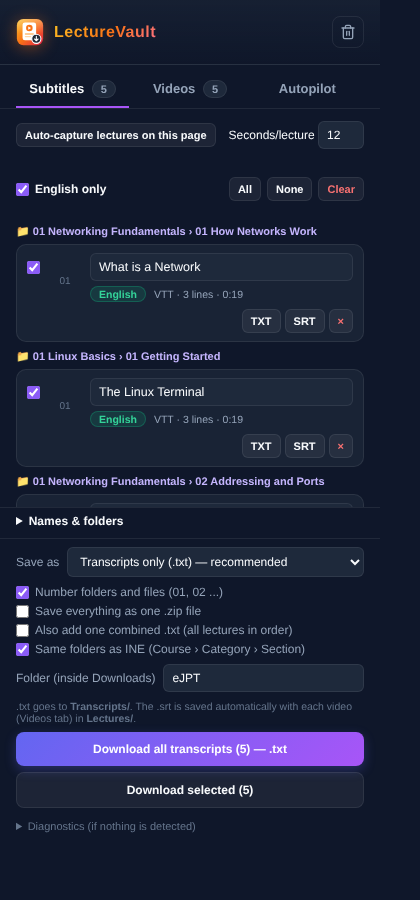

# 1 · Quick start

[← Back to README](../README.md)

Goal: install LectureVault and save your first transcript in about 5 minutes.

---

## Step 1 — Install (once)

1. Open Chrome and go to `chrome://extensions`.
2. Turn on **Developer mode** (switch, top-right).
3. Click **Load unpacked** and select this project folder (the one containing `manifest.json`).
4. LectureVault appears in the list. Click the **puzzle-piece** icon in the toolbar → 📌 pin **LectureVault**.

> 💡 **Keep the folder in the same place.** Chrome remembers the extension by its folder path. If you move or rename the folder, Chrome treats it as a *new* extension and your saved lists and settings are gone.

## Step 2 — Capture a lecture

1. Open a course page and **play a lecture** for a few seconds.
2. Click the LectureVault icon. The **Subtitles** tab shows the lecture with its course, section and number.



## Step 3 — Download it

- **Download all transcripts — .txt** saves every transcript in the list, in course order.
- Or tick only the ones you want and press **Download selected**.

Files go to:

```text
Downloads/
└── eJPT/
    └── Transcripts/
        └── 01 Networking Fundamentals/
            ├── 01 How Networks Work/
            │   └── 01 What is a Network.txt
            └── 02 Addressing and Ports/
                ├── 01 IP Addresses and Subnets.txt
                └── 02 Ports and Protocols.txt
```

*(Real output from a demo run. With INE pages the path-section, course, category and card numbers come from the course page itself.)*

## Step 4 — Updating the extension later

When the code changes: `chrome://extensions` → click **⟳** on LectureVault. If a course tab was already open, refresh it (F5) too.

---

## What next?

| I want to… | Go to |
|---|---|
| Change transcript format, zip them, combine them | [Transcripts only](02-transcripts.md) |
| Download videos without eating all my data | [Videos & data saver](03-videos-and-data-saver.md) |
| Grab a whole course page fast | [Auto-capture](04-auto-capture.md) |
| Run a whole learning path unattended | [Autopilot](05-autopilot.md) |
