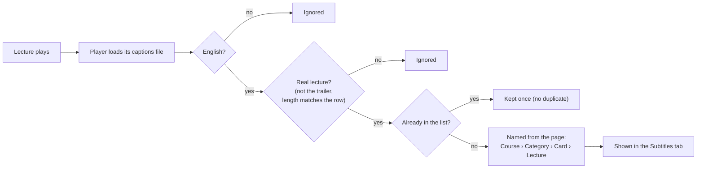
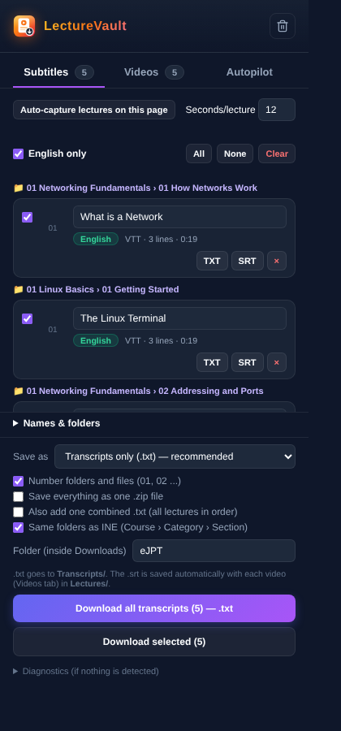

# 2 · Transcripts only

[← Back to README](../README.md)

Use this when you only want the **text** of the lectures (smallest, fastest, almost no data).

---

## How a transcript gets into the list

## The Subtitles tab, control by control

| Control | What it does |
|---|---|
| **English only** ✅ | Captures and shows English captions only. Turn off to see other languages. |
| **All / None** | Tick or untick everything shown. Your ticks are remembered when the popup closes. |
| **Clear** | Empties the list (files you already downloaded are not touched). |
| ✏️ Name box | Rename a lecture before downloading. |
| **TXT / SRT** (per row) | Download just that one lecture. |
| **×** (per row) | Remove that one entry. |
| **Names & folders** | Fix a wrong name: pick another title source, or click the right text on the page. |

### "Save as" options

| Option | Result |
|---|---|
| **Transcripts only (.txt)** — recommended | Clean text, one file per lecture, in `Transcripts/` |
| **Subtitles only (.srt)** | Timed subtitles, saved into the matching `Lectures/` folders (next to videos) |
| **Both** | `.txt` and `.srt` |
| **Number folders and files (01, 02 …)** ✅ | Keeps course order when sorted by name |
| **Save everything as one .zip** | One archive instead of many files |
| **Also add one combined .txt** | One extra file with all lectures in order — handy for searching or feeding to an AI for notes |
| **Same folders as INE** ✅ | `Course › Category › Section` folders. Off = all files in one folder |
| **Folder (inside Downloads)** | Default `eJPT` |

## Recipes

**All transcripts of everything I watched, sorted** → *Save as: .txt* → **Download all transcripts**.

**Only one course** → **None** → tick that course's lectures → **Download selected**.

**One big searchable file** → tick *Also add one combined .txt* → download.

**Transcripts without watching each video yourself** → use [Auto-capture](04-auto-capture.md) on the course page, then come back here.

## Good to know

- Transcripts use **almost no data** — a few KB each.
- The list holds up to **600** entries; the oldest drop off after that. Download, then **Clear**, once a course is done.
- Nothing is captured if the lecture never plays (the player only loads captions when a video starts).
