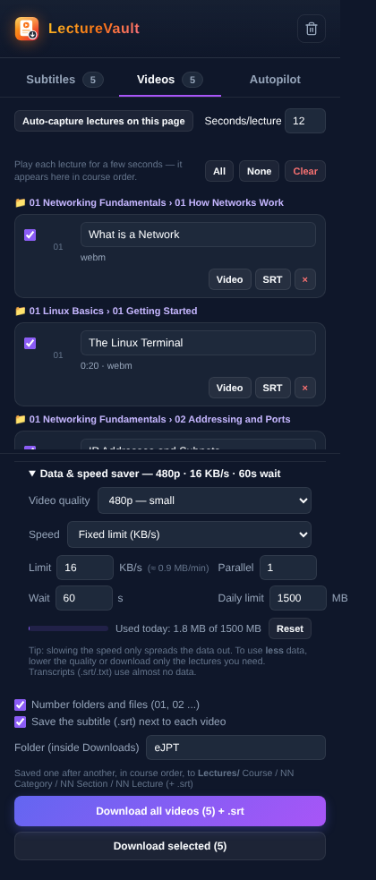
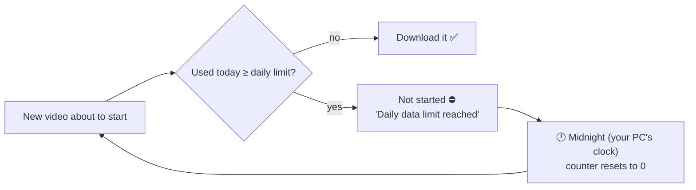

# 3 · Videos & the Data-and-speed saver

[← Back to README](../README.md)

Use this when you want the **lecture videos** too, on a limited connection (e.g. 4G with ~2 GB/day) and a laptop that lags under load.

---

## The Videos tab

| Control | What it does |
|---|---|
| Lecture list | Every lecture video you played, grouped and in course order. Tick the ones you want. |
| **Video / SRT** (per row) | Download only that video or only its subtitle. |
| **Download all videos + .srt** | Downloads every ticked video **one after another**, each with its `.srt`. |
| **Stop after this video** | Ends a running batch cleanly once the current video is saved. |
| **Number folders and files** ✅ | Keeps course order. |
| **Save the subtitle (.srt) next to each video** ✅ | Handy for watching offline with subtitles. |
| **Folder (inside Downloads)** | Default `eJPT` → videos go to `eJPT/Lectures/…` |

---

## Data & speed saver — every setting explained

> 🔑 **The one rule to remember:** *Quality decides how much data a video uses. Speed only decides how fast that data is used.* A slower download does **not** use less data.

### 1. Video quality — controls **how much data**

| Choice | Data per video | When to use |
|---|---|---|
| **360p** — least data | ≈ ⅓ of 720p | Slides/terminal are still readable on most lectures; best on 2 GB/day |
| **480p** — small | ≈ ½ of 720p | Good balance for screen recordings |
| **720p** — balanced *(default)* | baseline | Clear text in demos |
| **1080p** — large | ≈ 2× of 720p | Only on Wi-Fi |
| **Best available / Lowest available** | the highest / lowest the course offers | |

> Rough idea only (bitrates vary per course): 360p ≈ 0.5–1 MB per minute of video, 720p ≈ 2–5 MB/min, 1080p ≈ 5–10 MB/min. Check the **Used today** bar after one video to see real numbers.

### 2. Speed — controls **how fast** (and how hard your laptop works)

**By video length** (the slider) — download time is a share of the lecture's own length:

| Slider step | Factor | A 5-min lecture downloads in | A 10-min lecture downloads in | Feels like |
|---|---|---|---|---|
| **Very slow** | 1.0× | ~5 min | ~10 min | gentlest; like watching it live |
| **Like watching** *(default)* | 0.8× | ~4 min | ~8 min | normal streaming |
| **A bit faster** | 0.6× | ~3 min | ~6 min | |
| **Half time** | 0.5× | ~2½ min | ~5 min | |
| **One-third time** | 0.33× | ~1 min 40 s | ~3 min 20 s | |
| **Quarter time** | 0.25× | ~1¼ min | ~2½ min | fastest paced mode |

In this mode videos are fetched **one piece at a time**, so the laptop stays light.

**Fixed limit (KB/s)** — a hard cap on total speed for *all* downloads together. The box shows it in MB/min too (250 KB/s ≈ 15 MB/min ≈ 2 Mbps).

**Full speed** — no limit. Fastest, but your connection is saturated and an 8 GB laptop may lag.

> On slow 4G the faster steps can't go faster than your network. The slider sets a *maximum* pace, not a guaranteed one.

### 3. Parallel — how many video pieces at once (1–5)

| Value | Effect |
|---|---|
| **1** *(default)* | Lightest on CPU and RAM. Recommended for an 8 GB laptop. |
| 2–3 | Faster on good Wi-Fi; more RAM. |
| 4–5 | Only on a strong PC with fast internet; can make the browser lag. |

Ignored in *By video length* mode (always 1).

### 4. Wait — rest between videos (default 60 s)

Pause after each video in a batch. Spreads the load and gives the laptop a breather. Set 0 for no pause.

### 5. Daily data limit — the "24-hour limit" (default 1500 MB)

- Counts video data downloaded **through LectureVault** today (and, during Autopilot, what the course player streams).
- Resets at **midnight on your PC's clock** — a calendar day, not a rolling 24 hours.
- A video that already started is allowed to **finish**.
- **0** = no limit. **Reset** sets today's counter back to 0.
- It does **not** know about your phone's total data (WhatsApp, updates etc. are not counted). Keep it below your real plan — e.g. **1200–1500 MB** on a 2 GB/day plan.
- ⚠️ **Autopilot ignores this limit** (by design, so it never stops overnight). Control Autopilot's data with quality instead — see [Autopilot](05-autopilot.md).
- This is LectureVault's own limit. The course website may have its own fair-use rules in its terms — see [Risks & safe use](06-risks-and-safe-use.md).

---

## Ready-made setups

| Situation | Quality | Speed | Parallel | Wait | Daily limit |
|---|---|---|---|---|---|
| 📱 4G, 2 GB/day, laptop lags | **360p–480p** | Like watching | 1 | 60–120 s | 1200 MB |
| 🌙 Overnight on 4G | 360p | Very slow or Like watching | 1 | 120 s | 1500 MB |
| 🏠 Good Wi-Fi, want it quick | 720p | Half time or Quarter time | 1–2 | 30 s | 0 (off) |
| 🧪 Just transcripts | — | — | — | — | — (transcripts use almost no data) |

## What happens if I push it?

| If you… | What happens |
|---|---|
| Use **Full speed + Parallel 5** on 4G | Connection fully busy (browsing crawls), laptop fans up, 2 GB can be gone in under an hour at 720p |
| Set **1080p** on mobile data | Each video costs ~2× 720p; daily limit is reached after a few lectures |
| Set **Daily limit 0** | Nothing stops new downloads — you can use your whole plan before you notice |
| Set **Wait 0** with fast speed | Back-to-back downloads with no pause; heavy, steady traffic all night |
| Keep defaults (720p, Like watching, 1, 60 s, 1500 MB) | Balanced: light on the laptop, ~normal streaming pace, stops at 1.5 GB |
