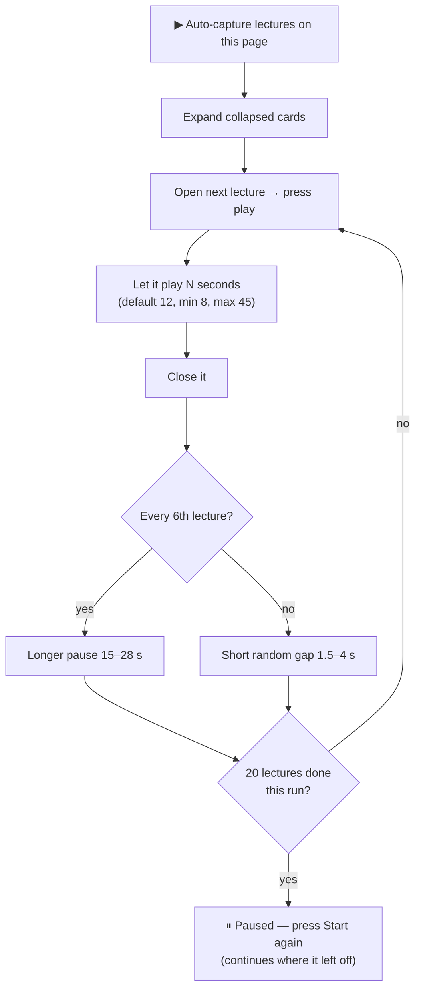

# 4 · Auto-capture (one course page)

[← Back to README](../README.md)

Use this to get the transcripts of **one course page** without clicking every lecture yourself.

---

## What it does

## How to use

1. Open the course page (the one listing its lectures).
2. Click LectureVault → **Auto-capture lectures on this page**.
3. Leave the tab in front. Each lecture plays for **Seconds/lecture** (12 by default).
4. After 20 lectures it pauses. Press it again to continue.
5. Go to the **Subtitles** tab → **Download all transcripts**.

| Setting | Default | Notes |
|---|---|---|
| **Seconds/lecture** | 12 | Long enough for the player to load captions. Raising it looks more like real viewing but takes longer. |
| Lectures per run | 20 (fixed) | Then it pauses until you click again. |
| Gaps | random 1.5–4 s | Longer 15–28 s pause every 6th lecture. |

## Auto-capture vs Autopilot

| | Auto-capture | Autopilot |
|---|---|---|
| Scope | Current course page | Whole learning path |
| Plays each lecture | ~12 seconds | 35–60% of its length |
| Saves files itself | ❌ (you download from the tab) | ✅ transcripts + videos |
| Stops by itself | After 20 lectures | Never (only Stop) |
| Data | Very little | A lot |

## Good to know

- It's a **quick sampler**: very short plays in a row are less like normal viewing than Autopilot's longer watching. Don't run it over many courses back-to-back — see [Risks & safe use](06-risks-and-safe-use.md).
- Stop it with the **Stop** button that appears while it runs; it finishes the current lecture first.
- If a page doesn't advance, play one lecture by hand and use the Subtitles tab, or tell the developer (me) the page changed.
