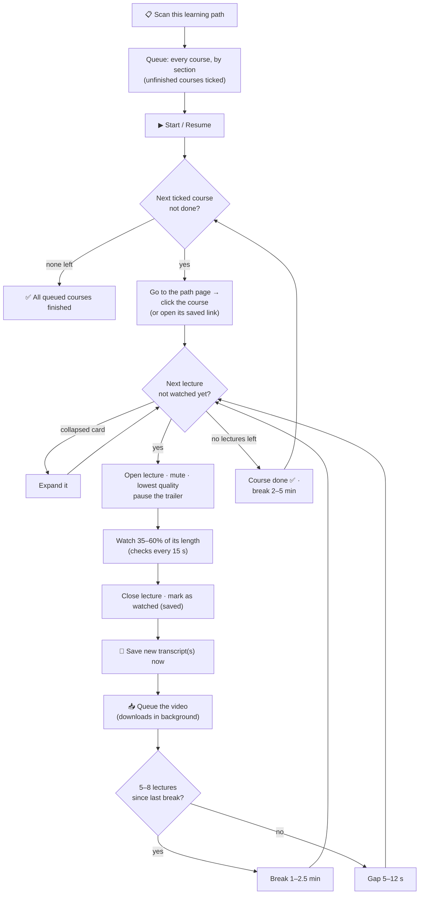
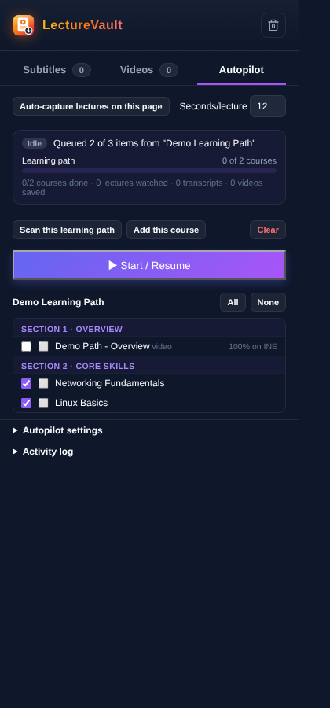
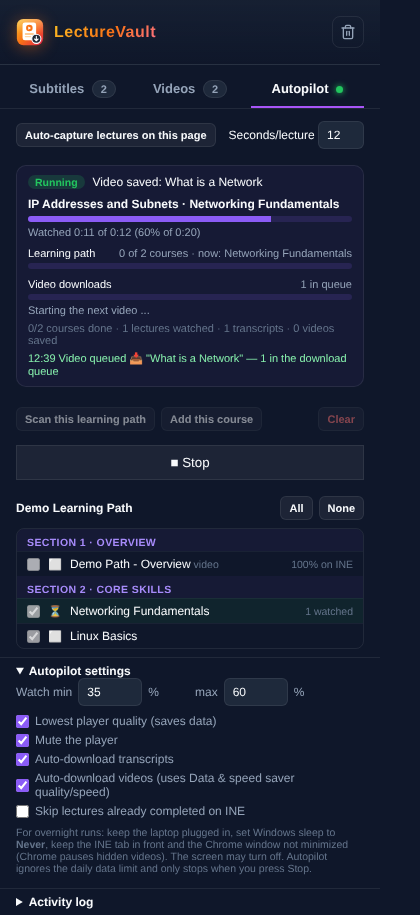
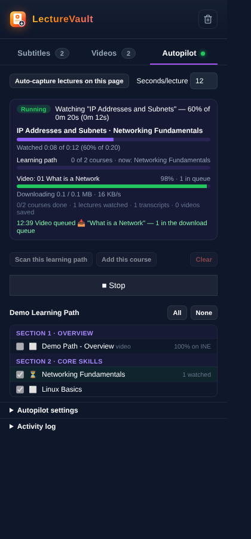
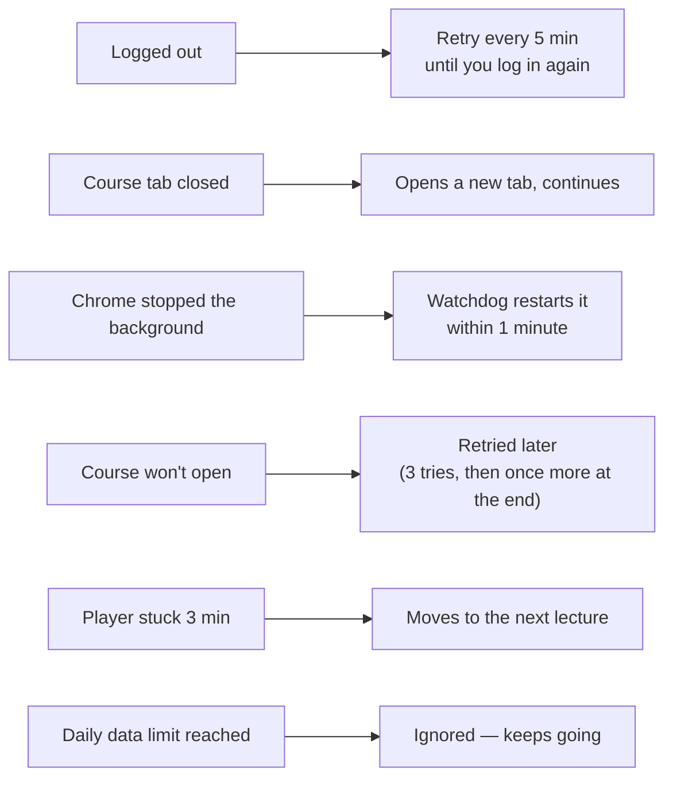

# 5 · Autopilot (a whole learning path, unattended)

[← Back to README](../README.md)

Autopilot goes through a **learning path course by course and lecture by lecture**, watches part of every lecture, and **saves the transcripts (and videos) by itself**. It's built to run for hours — e.g. overnight.

> ⚠️ This is the heaviest feature: most data, most automation. Read **[Risks & safe use](06-risks-and-safe-use.md)** and the **[Habits to remember](#-habits-to-remember-every-time)** below before the first run.

---

## The whole flow



## How long does a lecture take?

Autopilot watches **between 35% and 60%** of each lecture (you can change both numbers). Short lectures get closer to 60%, long ones closer to 35%, with ±5% randomness:

| Lecture length | Watched (about) | Time spent |
|---|---|---|
| 3 min or less | ~55–60% | ~1½–2 min |
| 10 min | ~45–50% | ~4½–5 min |
| 20 min or more | ~35–40% | ~7–8 min (for 20 min) |

Plus gaps (5–12 s), breaks (1–2.5 min every 5–8 lectures) and 2–5 min between courses. **Rule of thumb: a course with 3 h of video takes about 1½–2 h.**

## Step by step

### 1. Prepare (once per session)
- Laptop **plugged in**. Windows **Settings → System → Power → Sleep: Never** (screen-off is fine).
- Turn off the lock screen during the run.
- Videos tab → **Data & speed saver**: choose the video quality you want to *download* (360p–480p on mobile data).
- Logged in to the course site in Chrome.

### 2. Scan the learning path
1. Open the **learning path page** (the one listing every course).
2. **Scroll to the bottom once** so every course loads.
3. LectureVault → **Autopilot** tab → **Scan this learning path**.



- Courses are listed by **section**. Courses not yet 100% complete on the site are **ticked**.
- Untick what you don't need (**All / None** buttons help). Videos/labs in the path are listed but not ticked.
- Only want one course? Open that course page → **Add this course**.

### 3. Check the settings



| Setting | Default | What it means |
|---|---|---|
| **Watch min / max %** | 35 / 60 | Share of each lecture to watch (long → min, short → max) |
| **Lowest player quality** | ✅ | The *player* streams at its lowest quality while watching — saves lots of data. Doesn't affect downloaded videos. |
| **Mute the player** | ✅ | Silent at night |
| **Auto-download transcripts** | ✅ | Saves each transcript right after its lecture (uses the Subtitles-tab format & folder) |
| **Auto-download videos** | ✅ | Queues each lecture's video; downloads in the background with the Data & speed saver quality/speed. **Untick for transcripts only.** |
| **Skip lectures already completed** | ❌ | Skip lectures the site already marks as finished |
| **Max lectures/day** | 0 (off) | *Optional.* Stops after this many lectures in one calendar day. `0` = no cap. Counter resets at midnight. Shown as "Today: N lectures". |
| **Stop after** (slider) | Off | *Optional.* How long this run may last: **Off · 30 min · 1 h · 1½ h · 2 h · 3 h · 4 h · 6 h · 8 h**. Counted from when you press **Start / Resume**. The lecture that is playing is finished first, then Autopilot stops. |

#### ⏱ The *Stop after* slider (run time)
Works like the speed slider in the Videos tab — drag it to a step:

| Slider | Autopilot runs for… | Good for |
|---|---|---|
| Off | until you press Stop (or a limit below) | when you are at the laptop |
| 30 min / 1 h | a short session | testing, one small course |
| **1½ h / 2 h** | **a normal study session** | **recommended for most nights** |
| 3 h – 8 h | a long session | only with a low *Max lectures/day* — long runs = more videos |

- While running, the slider shows **"⏱ stops in 1 h 25 min"**.
- When the time is up you see *"⏱ Run time of 2 h reached — Autopilot stopped"*. **Start / Resume** later continues from the same lecture, with a fresh timer.
- Changing the slider during a run takes effect on the next Start / Resume.

> ### 🛑 Daily rule — read this every time
> - **Never download more than 30–40 videos in one day.**
> - **After 30–40 videos, take a full day off** (alternate days is best) — **or at least a 10–14 hour gap** before the next run.
> - Easy way to follow it: set **Stop after** to about **2 h** and/or **Max lectures/day** to **30**, and don't start again the same day.
> - If INE ever shows *"The user has watched the maximum number of minutes. Please wait 24 hours or contact the support team"* — you already went too far. Autopilot stops by itself; **wait the full 24 hours** and do less next time.


> 💡 **Transcripts only, no videos:** untick *Auto-download videos*. Data use then = just the player streaming at lowest quality.

### 4. Start
Press **▶ Start / Resume**. Keep the course tab **in front** and Chrome **not minimized** (Chrome pauses hidden videos).



What you see:
- **Current lecture** + purple bar: watched time vs target.
- **Learning path** bar: courses done out of ticked.
- **Video** bar (green): the video downloading in the background, its %, MB, speed and queue.
- **Last line**: "Transcript saved ✅" / "Video queued 📥" — or ⚠️ if something wasn't captured.
- **Activity log** (bottom): everything that happened, newest first.

### 5. Stop / resume
- **■ Stop** ends after the current step. **Start / Resume** continues from the **same course and lecture** — even days later.
- **Redo** (on a finished course) runs it again from its first lecture.
- **Clear** empties the queue (downloaded files are not touched).

## When does it stop?

It stops **only** for these reasons — everything else (log-out, closed tab, stuck player…) is retried, see the next diagram:

| Reason | Message in the log | What to do |
|---|---|---|
| You pressed **■ Stop** | "Stopped by you" | Resume whenever you like |
| **Stop after** time is up | "⏱ Run time of … reached" | Take a break (see the daily rule) |
| **Max lectures/day** reached (if set) | "🛑 Daily lecture cap reached" | Next run tomorrow at the earliest |
| **INE shows its viewing limit** (*"watched the maximum number of minutes… wait 24 hours"*) | "⛔ INE daily viewing limit reached" | Autopilot refuses to start again for **24 hours**. Wait, then run less. |
| All ticked courses done | "all ticked courses are done" | — |

## It recovers from everything else



With *Stop after* = Off and no daily cap, **it will use data all night** if you let it. Control it with *Stop after*, *Max lectures/day*, quality settings and by choosing fewer courses.

## Where files go

```text
Downloads/eJPT/
├── Transcripts/<Course>/<Card>/NN Lecture.txt      ← right after each lecture
└── Lectures/<Course>/<Card>/NN Lecture.webm|.ts    ← in the background, with .srt
```

---

## 🧠 Habits to remember (every time)

LectureVault already randomizes its own timing (watch %, gaps, breaks). **Your** habits matter just as much — keep your usage close to how a normal student studies:

- 🔀 **Change the settings between runs.** Don't use the same *Watch min/max %* every night — e.g. 35/60 one night, 40/65 another, 45/70 another. Change the **Wait** between videos and the **speed step** too.
- 🕐 **Start at different times**, not 1:00 AM sharp every night.
- 📏 **Do less per run:** 1–2 courses per night instead of a whole path in one go. Use **Stop after ≈ 2 h**.
- 🔢 **Max 30–40 videos a day**, then a day off — or at least a **10–14 hour gap**.
- 📅 **Not every night.** Leave gaps of a day or two.
- 👀 **Mix in real watching.** Study some lectures yourself, normally, in between.
- 🛑 **If the site ever shows a CAPTCHA, a warning or a "suspicious activity" message: stop, solve it yourself, and pause automation for a while.** Never try to get around it.

> **Be honest with yourself:** none of this makes automation invisible. Varying settings only keeps your usage *closer to normal*; **doing less** is what really keeps risk low. See [Risks & safe use](06-risks-and-safe-use.md).

## Quick troubleshooting

| You see | Do this |
|---|---|
| ⚠️ "No transcript was captured for …" | The captions didn't load while it played. Play that lecture by hand once, then download from the Subtitles tab. |
| ⚠️ "No video stream was captured" | Same — the stream wasn't seen. Normal for non-video items. |
| Stuck on "Going back to the learning path…" | The path page didn't show its course tiles. Open the path page yourself, scroll down, press Resume. |
| "INE seems logged out" | Log in again in the same Chrome — it continues by itself. |
| 0 videos after a long time | Videos are slow on purpose (e.g. Like watching ≈ 0.8× lecture length). Check the green video bar. |

More: [Troubleshooting](07-troubleshooting.md).
