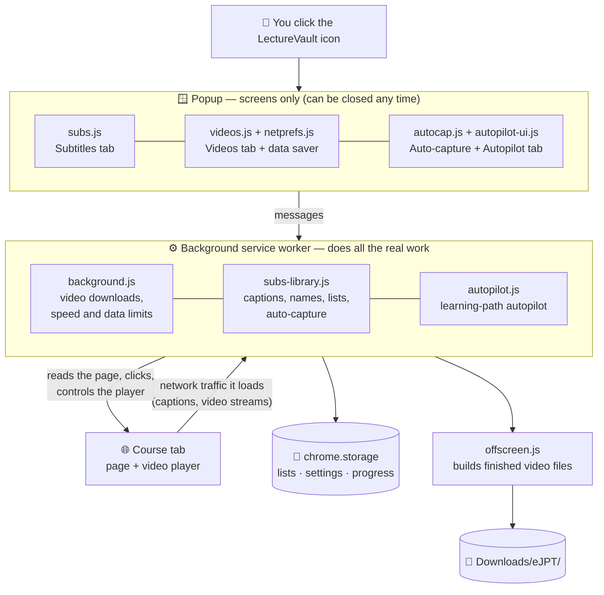
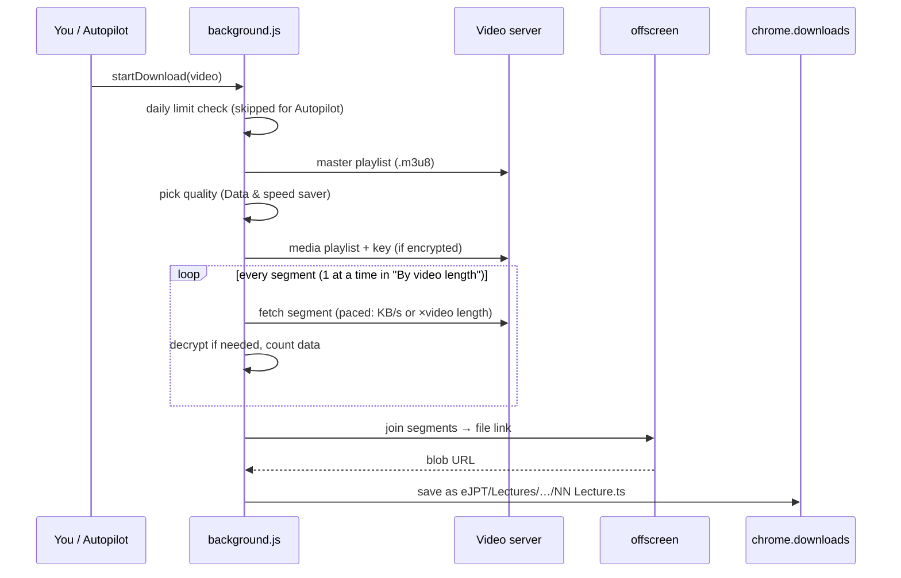

# 8 · How it works (for changing the code)

[← Back to README](../README.md)

A map of the code so you can find your way around even after a long break.

---

## The parts

- `background.js` loads the others with `importScripts('subtitle-utils.js', 'subs-library.js', 'autopilot.js')`.
- The popup can close at any time — all real work lives in the background script.

## File responsibilities

| File | Responsible for |
|---|---|
| `manifest.json` | Name, version, permissions (`downloads`, `webRequest`, `scripting`, `storage`, `alarms`, `offscreen`, …) |
| `background.js` | Detecting video streams; HLS download (playlist → quality pick → segments → decrypt AES-128 → join); MP4/WEBM download; **Data & speed saver** (pace, KB/s limiter, parallel, daily data counter); keep-alive |
| `subs-library.js` | Capturing caption files from network traffic; English filter; duplicate check; reading the course page to name lectures; Subtitles & Videos lists; batch downloads; **Auto-capture** |
| `autopilot.js` | **Autopilot**: path scan, course queue, opening/watching/closing lectures, auto-download, watchdog, recovery |
| `subtitle-utils.js` | VTT/SRT parsing, clean `.txt` output, name cleaning, folder/number helpers |
| `popup.*`, `subs.js`, `videos.js`, `netprefs.js`, `autocap.js`, `autopilot-ui.js` | The popup screens (one script per area) |
| `offscreen.*` | Creates file links for finished videos (service workers can't do that themselves) |

## Video download pipeline (HLS)

## Autopilot reliability tricks

| Problem | Solution in code |
|---|---|
| Chrome kills idle service workers after ~30 s | `nap()` sleeps in ≤15 s chunks and touches storage each time (keeps it alive) |
| Chrome still stops it sometimes | `autopilot-watchdog` alarm every minute restarts the loop from saved state |
| Progress lost on restart | Saved after every lecture in `chrome.storage.local['autopilot']` |
| Course trailer confused with lecture | `apPlayer()` only controls the player inside the lecture list; pauses/mutes others |
| Old "already downloaded" lists | Only items captured since the queue started (`ap.since`) are downloaded |

## Where data is stored (`chrome.storage.local`)

| Key | Contents |
|---|---|
| `subtitleLibrary`, `subtext_<id>` | Captured transcripts (list + text) |
| `videoLibrary` | Captured lecture videos |
| `subtitlePrefs`, `videoPrefs` | Tab settings (format, folder, numbering…) |
| `subsUnticked`, `videoUnticked` | What you unticked |
| `netPrefs`, `dataUsage` | Data & speed saver settings, today's MB |
| `autopilot` | Queue, progress, settings, activity log |
| `subtitleNaming`, `subtitleCandidates` | Naming choices and helpers |

Nothing is sent anywhere — all data stays in your browser and your Downloads folder.

## Testing changes

During development the extension was tested with **Playwright + Chromium** against local demo pages that copy the course page structure (path page, course page with lecture rows, a trailer player, captions, HLS streams). Typical loop: edit → `node --check *.js` → reload in `chrome://extensions` → try on one lecture → then on a short course.
